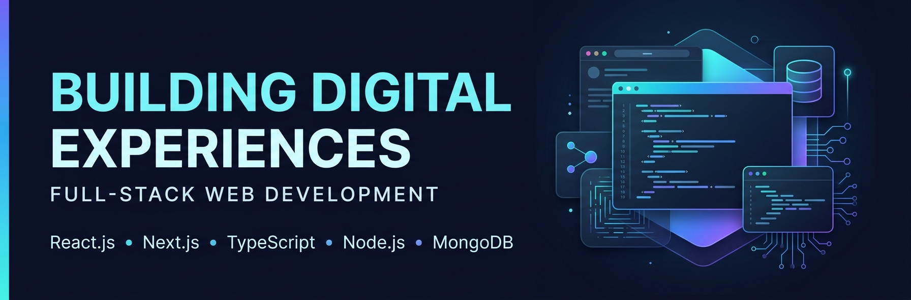
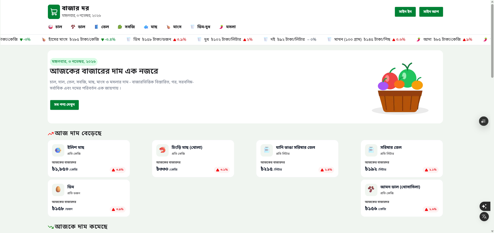
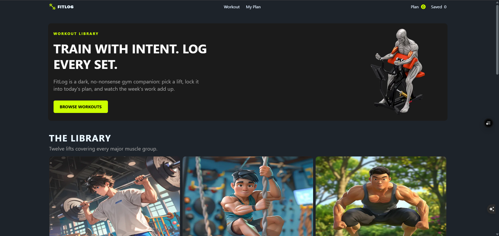
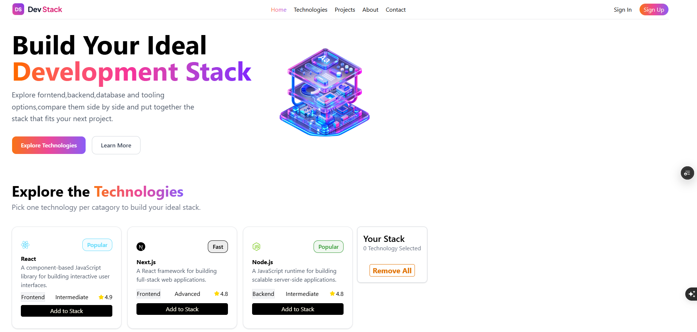

<!--
  Mohammad Rakibul Hasan
  GitHub Profile README
-->

  

<h1 align="center">Mohammad Rakibul Hasan</h1>

<h3 align="center">
  Full-Stack Web Developer | React.js | Next.js | TypeScript
</h3>

  Building modern web applications with clean interfaces,
  reliable functionality, and thoughtful user experiences.

  
  

---

## About Me

I'm a Computer Science and Engineering student and web developer from Bangladesh, focused on building modern, responsive, and functional web applications.

I enjoy transforming ideas into practical digital products, developing intuitive user interfaces, and solving real-world problems through technology.

My current focus is full-stack web development, with particular interest in the React and Next.js ecosystem.

- Building responsive and user-friendly web applications.
- Developing frontend experiences with React and Next.js.
- Working with APIs, databases, and authentication.
- Improving application architecture and code quality.
- Exploring AI integration into modern web applications.

## What I Can Help You Build

- **Business Websites:** Modern, responsive websites for businesses and brands.
- **Web Applications:** Interactive applications with practical functionality.
- **Dashboards:** Data-driven interfaces and management dashboards.
- **Frontend Development:** Responsive UI implementation from Figma designs.
- **API Integration:** Connecting frontend applications with backend services.

I'm open to freelance opportunities and collaborations.

---

## Technology Stack

### Frontend Development

  

### Backend & Database

  

### Development Tools

  

---

## 🚀 Featured Projects

### 🛒 01. Bazardor — Bangladesh Market Price Platform

A web application designed to help users explore and track daily market prices of essential products across Bangladesh.

**Key Features**
- Dynamic product and category management.
- Daily market price tracking.
- Authentication integration.
- Responsive and user-friendly interface.

  

**Tech Stack:** Next.js · TypeScript · Tailwind CSS · MongoDB

  
  

---

### 🏋️ 02. FitLog — Workout Tracking Application

A workout application designed to help users explore exercises and organize their personal workout plans.

**Key Features**
- Workout library and exercise details.
- Personal workout plan management.
- Interactive exercise interface.
- Responsive application design.

  

**Tech Stack:** Next.js · React · Tailwind CSS

  
  

---

### 🧩 03. Dev Stack Builder — Technology Discovery Platform

An interactive platform that helps developers discover technologies and build personalized development stacks.

**Key Features**
- Technology discovery and exploration.
- Interactive stack-building functionality.
- Dynamic technology data.
- Responsive user interface.

  

**Tech Stack:** React · TypeScript · Tailwind CSS

  
  

---

## 📊 GitHub Analytics

  
  

  

---

## Currently Growing

I'm continuously improving my development skills and expanding my knowledge in:

- Advanced Next.js and full-stack architecture.
- Backend development and REST API design.
- MongoDB and database optimization.
- Authentication and application security.
- AI integration and intelligent web applications.

---

## Let's Build Something Together

Have a project idea, need a website, or looking for a developer to collaborate with?

I'd be happy to connect and discuss how I can contribute.

  

  <i>Build with purpose. Develop with passion. Deliver with quality.</i>

